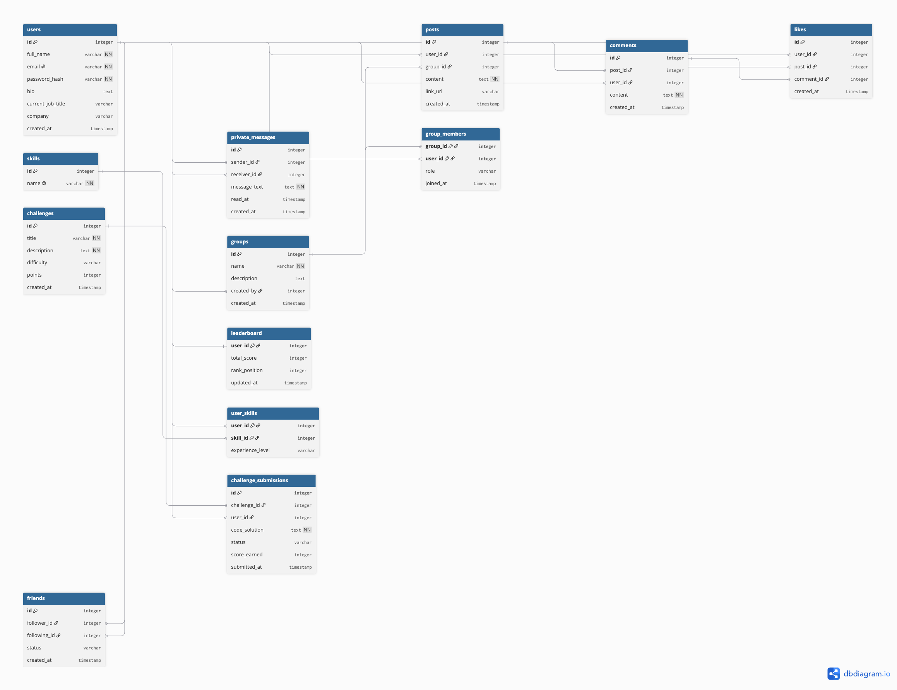

# 🌐 Social Network Database — Rede Social para Desenvolvedores

Repositório contendo a modelagem e os scripts SQL para o banco de dados de uma **rede social voltada para desenvolvedores**, onde os usuários podem compartilhar postagens, trocar mensagens, participar de grupos temáticos e resolver desafios de programação.

---

## 📁 Estrutura do Projeto

```
social-network-db/
├── docs/
│   ├── diagrama.png          # Diagrama ER exportado em imagem
│   └── diagrama_exec.sql     # Código DBML usado no dbdiagram.io
├── sql/
│   └── social_network.sql    # Script DDL completo para criação do banco
└── README.md
```

---

## 📊 Diagrama ER



> Diagrama gerado com [dbdiagram.io](https://dbdiagram.io).

---

## 🗂️ Tabelas do Banco de Dados

| Tabela | Descrição |
|--------|-----------|
| `users` | Cadastro de usuários com informações pessoais e profissionais |
| `posts` | Postagens dos usuários contendo texto e links (pessoais ou em grupos) |
| `friends` | Conexões entre usuários — seguidores e amigos |
| `comments` | Comentários feitos nas postagens |
| `likes` | Curtidas em postagens e comentários |
| `private_messages` | Sistema de mensagens privadas entre usuários |
| `skills` | Catálogo de habilidades de programação |
| `user_skills` | Habilidades associadas a cada usuário (com nível de experiência) |
| `groups` | Grupos temáticos sobre linguagens e tecnologias |
| `group_members` | Membros participantes de cada grupo |
| `challenges` | Desafios de programação disponíveis |
| `challenge_submissions` | Soluções enviadas pelos usuários para os desafios |
| `leaderboard` | Ranking dos usuários baseado na participação nos desafios |

---

## 🛠️ Tecnologias Utilizadas

- **DBML / dbdiagram.io** — Modelagem relacional e geração do diagrama ER
- **SQL (PostgreSQL)** — Script DDL para criação das tabelas, constraints, triggers e índices

---

## ✨ Funcionalidades Modeladas

- ✅ Cadastro de usuários com dados pessoais e profissionais
- ✅ Postagens com texto e links
- ✅ Curtidas em posts e comentários
- ✅ Comentários em postagens
- ✅ Mensagens privadas entre usuários
- ✅ Sistema de seguidores (seguir/ser seguido)
- ✅ Habilidades de programação dos usuários
- ✅ Grupos temáticos com membros e postagens
- ✅ Desafios de programação com envio de soluções
- ✅ Ranking automático baseado nos desafios (com trigger)
